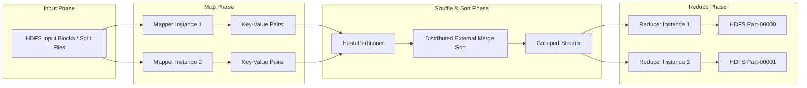

# Big Data & Distributed Computing: Hadoop MapReduce & Apache Spark

[](https://www.python.org/)
[](https://hadoop.apache.org/)
[](https://spark.apache.org/)
[](https://www.java.com/)
[](tests/test_mapreduce_pipelines.py)
[](LICENSE)

A comprehensive data engineering repository demonstrating distributed batch processing patterns, streaming MapReduce paradigms, and large-scale data analytics using **Apache Hadoop** and **Apache Spark**.

---

## Architecture & Distributed Execution Model

The repository implements the canonical Google / Hadoop MapReduce model across multiple languages and runtime environments, utilizing standard POSIX streaming pipes for zero-overhead Python orchestration and native Java bytecode for cluster-grade YARN execution.



---

## Core Components & Implementations

### 1. Python MapReduce Streaming (`python_mapreduce/`)
Leverages Hadoop Streaming (`hadoop-streaming.jar`) to execute arbitrary Python scripts over STDIN and STDOUT:
- **`word_count/`**: Standard distributed word frequency counter. Emits tokenized words as `(word, 1)` and performs constant-memory sliding key aggregation in the reducer.
- **`sales_analytics/`**: High-throughput processing pipeline for multi-gigabyte transaction datasets (`purchases.txt`). Extracts and aggregates total revenue segmented by retail store branch and merchandise category.
- **`advanced_aggregations/`**:
  - **Distributed Anagram Engine (`mapper_5.py` / `reducer_5.py`)**: Sorts token characters into a canonical signature key to group anagram clusters across distributed partitions.
  - **Temporal Event Filter (`mapper_4.py` / `reducer_4.py`)**: Multi-format datetime normalization and geopolitical event isolation across chronological intervals.

### 2. Java Hadoop MapReduce (`java_hadoop_mapreduce/`)
Cluster-ready Maven project featuring type-safe serialization primitives:
- `TokenizerMapper.java`: Maps input lines to `Text` tokens paired with `IntWritable(1)`.
- `IntSumReducer.java`: Combines intermediate counts to output cumulative frequencies.
- `WordCount.java`: Configures job properties, input/output paths, and submits execution to the Hadoop YARN Resource Manager.

### 3. Apache Spark Analytics (`spark_analytics/`)
- Interactive PySpark notebook (`lab_3_big_data.ipynb`) demonstrating resilient distributed datasets (RDDs), Spark DataFrames, SQL query execution plans, and scalable data transformations on municipal urban tree inventories (`arbres.csv`).
- Spark MLlib pipeline reference guide covering feature vector assembly, distributed regression, and clustering algorithms.

---

## Directory Structure

```plaintext
big-data-distributed-computing/
├── python_mapreduce/
│   ├── word_count/
│   │   ├── mapper.py                     # Tokenizer emitting (word, 1)
│   │   ├── reducer.py                    # Running-key accumulator
│   │   └── sample_input.txt              # Sample corpus for local verification
│   ├── sales_analytics/
│   │   ├── mapper_sales.py               # TSV/whitespace parser for transaction logs
│   │   ├── reducer_sales.py              # Store-level sales revenue aggregator
│   │   └── purchases_sample.txt          # Representative 50-row retail dataset
│   └── advanced_aggregations/
│       ├── mapper_4.py                   # Multi-format temporal event extractor
│       ├── reducer_4.py                  # Chronological event sequence aggregator
│       ├── mapper_5.py                   # Canonical character signature mapper
│       ├── reducer_5.py                  # Anagram cluster aggregator
│       └── lab2.py                       # Python data processing scripts
├── java_hadoop_mapreduce/
│   ├── pom.xml                           # Apache Maven dependency configuration
│   └── src/main/java/tp/
│       ├── WordCount.java                # Job driver & configuration
│       ├── TokenizerMapper.java          # Mapper implementation
│       └── IntSumReducer.java            # Reducer implementation
├── spark_analytics/
│   ├── lab_3_big_data.ipynb              # PySpark DataFrame operations & analytics
│   ├── Spark_MLlib_Guide.pdf             # Scalable machine learning specification
│   └── arbres.csv                        # Urban tree census dataset
├── tests/
│   └── test_mapreduce_pipelines.py       # Automated regression test suite (7 tests)
├── .gitignore                            # Excludes heavy binaries and large dataset dumps
└── README.md                             # Architectural documentation
```

---

## Quickstart & Verification

### 1. Run Automated Test Suite
The repository includes automated end-to-end unit tests validating streaming outputs, delimiters, and aggregations:
```bash
pytest tests/ -v
```
Expected output:
```plaintext
tests/test_mapreduce_pipelines.py::TestBigDataMapReducePipelines::test_anagram_mapreduce_pipeline PASSED
tests/test_mapreduce_pipelines.py::TestBigDataMapReducePipelines::test_end_to_end_sample_sales_pipeline PASSED
tests/test_mapreduce_pipelines.py::TestBigDataMapReducePipelines::test_event_date_filtering_pipeline PASSED
tests/test_mapreduce_pipelines.py::TestBigDataMapReducePipelines::test_sales_mapper_schema_parsing PASSED
tests/test_mapreduce_pipelines.py::TestBigDataMapReducePipelines::test_sales_reducer_store_totals PASSED
tests/test_mapreduce_pipelines.py::TestBigDataMapReducePipelines::test_wordcount_mapper_output PASSED
tests/test_mapreduce_pipelines.py::TestBigDataMapReducePipelines::test_wordcount_reducer_aggregation PASSED
============================== 7 passed in 0.52s ==============================
```

### 2. Local MapReduce Simulation (POSIX / PowerShell)
Hadoop streaming can be simulated locally without a running cluster using standard Unix pipes:

**Word Count Pipeline:**
```bash
cat python_mapreduce/word_count/sample_input.txt | python python_mapreduce/word_count/mapper.py | sort | python python_mapreduce/word_count/reducer.py
```

**Sales Analytics Pipeline:**
```bash
cat python_mapreduce/sales_analytics/purchases_sample.txt | python python_mapreduce/sales_analytics/mapper_sales.py | sort | python python_mapreduce/sales_analytics/reducer_sales.py
```

### 3. Build Java Hadoop Artifact
To build the JAR package for deployment on a production Hadoop cluster:
```bash
cd java_hadoop_mapreduce
mvn clean package
```
Submit the job to Hadoop:
```bash
hadoop jar target/wordcount-1.0-SNAPSHOT.jar tp.WordCount /hdfs/input/path /hdfs/output/path
```

---

## Distributed Performance & Optimization Notes

1. **Streaming Delimiters:** In Hadoop streaming, TSV (`\t`) is the canonical wire delimiter. Key parsers are configured to strictly split on tabs to support multi-word tokens (e.g. store names like "San Jose" or merchandise categories like "Men's Clothing").
2. **Memory Bounds:** Reducers maintain strict $O(1)$ memory usage by relying on Hadoop's distributed external merge sort to guarantee all values for key $k_i$ arrive contiguously before key $k_{i+1}$.
3. **Partition Pruning:** In Spark DataFrame workflows, filter predicates are pushed down to the storage layer before shuffle stages to minimize network I/O.
